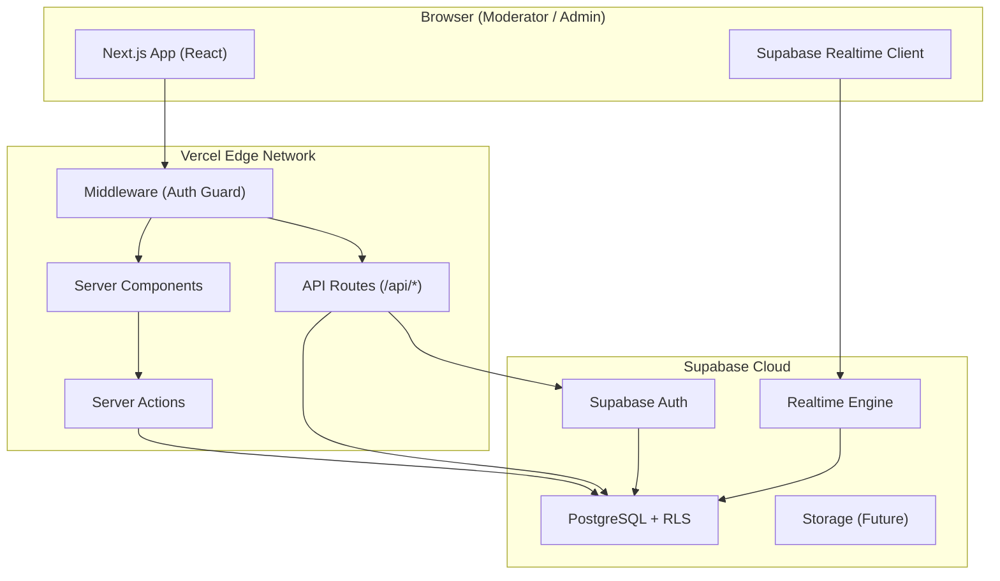
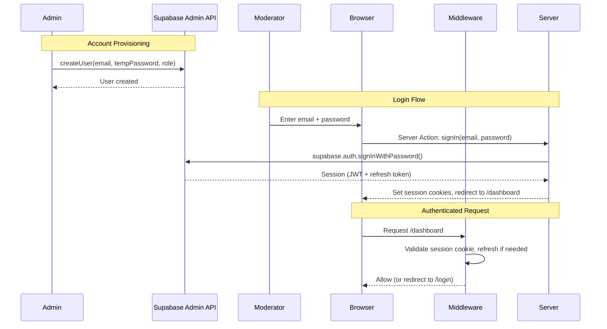
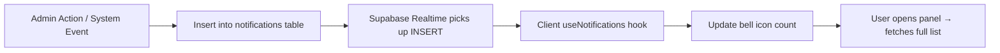

# Mercury Marketing — Architecture Document

> **Last Updated:** 2026-07-02
> **Status:** Draft
> **Related:** [PRD.md](file:///c:/Users/Angel/Desktop/CLIENT/CLOCKY/docs/PRD.md) · [RAW_CLIENTS_IDEA.md](file:///c:/Users/Angel/Desktop/CLIENT/CLOCKY/docs/RAW_CLIENTS_IDEA.md)

---

## Table of Contents

1. [Technology Stack](#technology-stack)
2. [System Architecture Overview](#system-architecture-overview)
3. [Project Structure](#project-structure)
4. [Database Schema](#database-schema)
5. [Authentication & Authorization](#authentication--authorization)
6. [API Design](#api-design)
7. [Realtime Features](#realtime-features)
8. [Timezone Handling](#timezone-handling)
9. [Middleware & Route Protection](#middleware--route-protection)
10. [State Management](#state-management)
11. [Notification System](#notification-system)
12. [Deployment & Infrastructure](#deployment--infrastructure)
13. [Environment Variables](#environment-variables)
14. [Key Design Decisions](#key-design-decisions)

---

## Technology Stack

| Layer | Technology | Rationale |
|-------|-----------|-----------|
| **Framework** | Next.js (App Router) | Full-stack React framework with Server Components, API routes, middleware, and SSR/SSG. App Router is the current standard. |
| **Language** | TypeScript | Type safety, better DX, fewer runtime errors. |
| **Database** | Supabase (PostgreSQL) | Managed Postgres with built-in Auth, Row Level Security (RLS), Realtime subscriptions, and auto-generated REST API. |
| **Auth** | Supabase Auth | Email/Password authentication with session management via JWTs. Role-based claims stored in `app_metadata` to avoid database lookups on edge middleware. |
| **ORM / DB Client** | `@supabase/ssr` & `@supabase/supabase-js` | Official Next.js helper packages to securely instantiate Supabase clients on server, middleware, and browser contexts using cookie storage. |
| **Styling** | Tailwind CSS v4 | CSS-first configuration via `@theme` directive. No `tailwind.config.js` needed. Design tokens from DESIGN.md map directly to `@theme` variables. |
| **Deployment** | Vercel | Native Next.js hosting, edge functions, automatic HTTPS, custom domain support. |
| **Realtime** | Supabase Realtime | WebSocket-based Postgres changes for live dashboard updates (moderator clock-in/out events, notifications). |
| **Timezone** | `Intl.DateTimeFormat` + `date-fns-tz` | Lightweight timezone handling. UTC storage, local display. |

---

## System Architecture Overview



### Request Flow

1. **Browser** → Vercel Edge (**Middleware**) — validates session cookie; redirects to `/login` if unauthenticated.
2. **Middleware** → **Server Component** — renders page with data fetched server-side via Supabase client.
3. **User Action** → **Server Action** — mutations (clock-in, save profile, etc.) execute server-side with the user's session.
4. **Realtime** — Supabase Realtime pushes Postgres changes (new shifts, notifications) to connected clients via WebSocket.

---

## Project Structure

```
mercury-marketing/
├── public/                          # Static assets (logo, favicon, etc.)
├── src/
│   ├── app/                         # Next.js App Router
│   │   ├── (auth)/                  # Auth route group (no sidebar layout)
│   │   │   ├── login/
│   │   │   │   └── page.tsx         # Login page
│   │   │   └── layout.tsx           # Auth layout (centered, no sidebar)
│   │   │
│   │   ├── (dashboard)/             # Authenticated route group (sidebar layout)
│   │   │   ├── dashboard/
│   │   │   │   └── page.tsx         # My Dashboard (moderator) or Admin Dashboard
│   │   │   ├── schedule/
│   │   │   │   └── page.tsx         # Team Schedule
│   │   │   ├── templates/
│   │   │   │   └── page.tsx         # Response Templates
│   │   │   ├── logs/
│   │   │   │   └── page.tsx         # My Log History
│   │   │   ├── availability/
│   │   │   │   └── page.tsx         # My Availability
│   │   │   ├── pay/
│   │   │   │   └── page.tsx         # My Pay
│   │   │   ├── settings/
│   │   │   │   └── page.tsx         # Settings (Profile + Password)
│   │   │   ├── admin/               # Admin-only pages
│   │   │   │   ├── users/
│   │   │   │   │   └── page.tsx     # User Management
│   │   │   │   └── logs/
│   │   │   │       └── page.tsx     # All Moderator Logs
│   │   │   ├── layout.tsx           # Dashboard layout (sidebar + header + notifications)
│   │   │   └── error.tsx            # Styled fallback UI for dashboard route failures
│   │   │
│   │   ├── api/                     # API Routes (for webhooks, admin ops)
│   │   │   ├── auth/
│   │   │   │   └── callback/
│   │   │   │       └── route.ts     # Supabase auth callback handler
│   │   │   └── admin/
│   │   │       ├── users/
│   │   │       │   └── route.ts     # Admin: create/deactivate users (service role)
│   │   │       └── pay/
│   │   │           └── route.ts     # Admin: approve/deny pay requests
│   │   │
│   │   ├── layout.tsx               # Root layout (html, body, fonts, global CSS)
│   │   ├── global-error.tsx         # Global crash fallback UI
│   │   ├── not-found.tsx            # 404 page
│   │   └── globals.css              # Global styles + CSS custom properties
│   │
│   ├── components/                  # Shared React components
│   │   ├── ui/                      # Primitives (Button, Card, Input, Modal, Badge, etc.)
│   │   ├── layout/                  # Sidebar, Header, NotificationBell
│   │   ├── dashboard/               # ClockWidget, ShiftStreak, PayWidget, StatsGrid
│   │   ├── schedule/                # WeekCalendar, DayView, ShiftBlock, Legend
│   │   ├── templates/               # TemplateCard, TemplateSearch, CategoryFilter
│   │   ├── logs/                    # LogEntry, LogList, LogFilters
│   │   ├── availability/            # DayRow, TimeInput, AvailabilityForm
│   │   ├── pay/                     # PayCard, RequestChangeModal
│   │   ├── settings/                # ProfileForm, PasswordForm, RoleDisplay
│   │   ├── admin/                   # UserTable, AdminStatsPanel, ActivityFeed
│   │   └── notifications/           # NotificationPanel, NotificationItem
│   │
│   ├── lib/                         # Utility libraries
│   │   ├── supabase/
│   │   │   ├── client.ts            # Browser Supabase client (anon key)
│   │   │   ├── server.ts            # Server Supabase client (reads cookies)
│   │   │   ├── admin.ts             # Admin Supabase client (service role key)
│   │   │   └── middleware.ts        # Supabase middleware helper (session refresh)
│   │   ├── actions/                 # Server Actions (grouped by feature)
│   │   │   ├── auth.ts              # login, logout
│   │   │   ├── clock.ts             # clockIn, clockOut, startBreak, endBreak
│   │   │   ├── availability.ts      # updateAvailability
│   │   │   ├── templates.ts         # CRUD templates (admin)
│   │   │   ├── pay.ts               # requestPayChange, approvePay, denyPay
│   │   │   ├── users.ts             # createUser, updateUser, deactivateUser (admin)
│   │   │   ├── settings.ts          # updateProfile, changePassword
│   │   │   └── notifications.ts     # markAsRead, markAllRead
│   │   ├── types/                   # TypeScript types + Supabase generated types
│   │   │   ├── database.types.ts    # Auto-generated from Supabase CLI
│   │   │   └── index.ts             # App-specific types (User, Shift, etc.)
│   │   ├── utils/
│   │   │   ├── timezone.ts          # UTC ↔ local timezone conversion helpers
│   │   │   ├── format.ts            # Date/time/currency formatting
│   │   │   └── constants.ts         # App-wide constants
│   │   └── hooks/                   # Custom React hooks
│   │       ├── useRealtimeShifts.ts # Listen for shift changes
│   │       ├── useNotifications.ts  # Listen for new notifications
│   │       └── useTimer.ts          # Client-side shift timer display
│   │
│   └── middleware.ts                # Next.js Middleware (auth guard + session refresh)
│
├── supabase/                        # Supabase local dev + migrations
│   ├── config.toml                  # Supabase project config
│   ├── migrations/                  # SQL migration files (version-controlled schema)
│   │   ├── 00001_create_profiles.sql
│   │   ├── 00002_create_shifts.sql
│   │   ├── 00003_create_schedules.sql
│   │   ├── 00004_create_templates.sql
│   │   ├── 00005_create_availability.sql
│   │   ├── 00006_create_pay.sql
│   │   └── 00007_create_notifications.sql
│   └── seed.sql                     # Seed data (admin user, sample templates)
│
├── .env.local                       # Environment variables (not committed)
├── next.config.ts                   # Next.js configuration
├── tsconfig.json                    # TypeScript config
├── package.json
└── README.md
```

---

## Styling System (Tailwind CSS v4 + DESIGN.md)

> Design system source: [DESIGN.md](file:///c:/Users/Angel/Desktop/CLIENT/CLOCKY/docs/DESIGN.md) — Linear-inspired dark canvas system.

### Tailwind v4 Installation

Tailwind v4 drops the `tailwind.config.js` file entirely. All configuration lives in CSS.

**1. Install:**
```bash
npm install tailwindcss @tailwindcss/postcss postcss
```

**2. Configure PostCSS (`postcss.config.mjs`):**
```javascript
export default {
  plugins: {
    '@tailwindcss/postcss': {},
  },
};
```

**3. Global CSS entry point (`src/app/globals.css`):**
```css
@import "tailwindcss";

/* All design tokens defined below via @theme */
```

**4. Root layout (`src/app/layout.tsx`):**
```tsx
import './globals.css';
```

Tailwind v4 auto-detects template files — no `content` array needed.

---

### Design Token Mapping (`@theme`)

All tokens from DESIGN.md are mapped to Tailwind v4 CSS variables via the `@theme` directive in `globals.css`.

```css
/* src/app/globals.css */
@import "tailwindcss";

@theme {
  /* ─── Colors — Surface Ladder (from DESIGN.md) ─── */
  --color-canvas:           #010102;  /* {colors.canvas} — deepest bg, near-pure black */
  --color-surface-1:        #0e0f11;  /* {colors.surface-1} — cards, panels */
  --color-surface-2:        #141518;  /* {colors.surface-2} — featured cards, hovered */
  --color-surface-3:        #1c1d21;  /* {colors.surface-3} — sub-nav, dropdowns */
  --color-surface-4:        #222428;  /* {colors.surface-4} — deepest lifted surface */

  /* ─── Colors — Hairlines ─── */
  --color-hairline:         #23252a;  /* {colors.hairline} — default 1px borders */
  --color-hairline-strong:  #2e3036;  /* {colors.hairline-strong} — input focus rings */
  --color-hairline-tertiary:#1a1c20;  /* {colors.hairline-tertiary} — nested surfaces */

  /* ─── Colors — Brand & Accent ─── */
  --color-primary:          #5e6ad2;  /* {colors.primary} — lavender-blue CTA, focus */
  --color-primary-hover:    #828fff;  /* {colors.primary-hover} — hovered CTA */
  --color-primary-focus:    #5e69d1;  /* {colors.primary-focus} — focus rings */
  --color-brand-secure:     #7a7fad;  /* {colors.brand-secure} — security surfaces */

  /* ─── Colors — Text / Ink ─── */
  --color-ink:              #f7f8f8;  /* {colors.ink} — headlines, body */
  --color-ink-muted:        #d0d6e0;  /* {colors.ink-muted} — secondary type */
  --color-ink-subtle:       #8a8f98;  /* {colors.ink-subtle} — tertiary type */
  --color-ink-tertiary:     #62666d;  /* {colors.ink-tertiary} — disabled, footnotes */

  /* ─── Colors — Inverse (rare white surfaces) ─── */
  --color-inverse-canvas:   #ffffff;
  --color-inverse-surface-1:#f5f5f5;
  --color-inverse-surface-2:#ebebeb;

  /* ─── Colors — Semantic ─── */
  --color-semantic-success: #27a644;  /* Status pills, success indicators */
  --color-semantic-overlay: #000000;  /* Modal scrims */

  /* ─── Typography — Font Families ─── */
  /* Linear custom fonts not publicly distributed. Use Inter + JetBrains Mono. */
  --font-sans: "Inter", "SF Pro Display", -apple-system, system-ui, "Segoe UI", Roboto, sans-serif;
  --font-mono: "JetBrains Mono", "SF Mono", ui-monospace, Menlo, monospace;

  /* ─── Typography — Font Sizes (from DESIGN.md hierarchy) ─── */
  --text-display-xl:  5rem;     /* 80px — largest hero headline */
  --text-display-lg:  3.5rem;   /* 56px — section opener headlines */
  --text-display-md:  2.5rem;   /* 40px — sub-section headlines */
  --text-headline:    1.75rem;  /* 28px — pricing titles, CTA banner */
  --text-card-title:  1.375rem; /* 22px — feature card titles */
  --text-subhead:     1.25rem;  /* 20px — lead body, intro paragraphs */
  --text-body-lg:     1.125rem; /* 18px — hero subhead */
  --text-body:        1rem;     /* 16px — default body */
  --text-body-sm:     0.875rem; /* 14px — card body, footer */
  --text-caption:     0.75rem;  /* 12px — captions, meta, status */
  --text-button:      0.875rem; /* 14px — all button labels */
  --text-eyebrow:     0.8125rem;/* 13px — section eyebrows */
  --text-mono:        0.8125rem;/* 13px — code snippets */

  /* ─── Typography — Letter Spacing ─── */
  --tracking-display-xl: -0.1875rem; /* -3.0px */
  --tracking-display-lg: -0.1125rem; /* -1.8px */
  --tracking-display-md: -0.0625rem; /* -1.0px */
  --tracking-headline:   -0.0375rem; /* -0.6px */
  --tracking-card-title: -0.025rem;  /* -0.4px */
  --tracking-subhead:    -0.0125rem; /* -0.2px */
  --tracking-body-lg:    -0.00625rem;/* -0.1px */
  --tracking-body:       -0.003125rem; /* -0.05px */
  --tracking-eyebrow:    0.025rem;   /* +0.4px — positive contrast */

  /* ─── Spacing (4px base unit from DESIGN.md) ─── */
  --spacing-xxs:     0.25rem;  /* 4px */
  --spacing-xs:      0.5rem;   /* 8px */
  --spacing-sm:      0.75rem;  /* 12px */
  --spacing-md:      1rem;     /* 16px */
  --spacing-lg:      1.5rem;   /* 24px — card interior padding */
  --spacing-xl:      2rem;     /* 32px — testimonial card padding */
  --spacing-xxl:     3rem;     /* 48px — CTA banner padding */
  --spacing-section: 6rem;     /* 96px — between sections */

  /* ─── Border Radius (from DESIGN.md shapes) ─── */
  --radius-xs:   0.25rem;    /* 4px — chips, status badges */
  --radius-sm:   0.375rem;   /* 6px — inline tags */
  --radius-md:   0.5rem;     /* 8px — buttons, form inputs */
  --radius-lg:   0.75rem;    /* 12px — cards, pricing cards */
  --radius-xl:   1rem;       /* 16px — product screenshot panels */
  --radius-xxl:  1.5rem;     /* 24px — oversized CTA banners */
  --radius-pill: 9999px;     /* pill toggles, status pills */
  --radius-full: 9999px;     /* avatar circles */

  /* ─── Breakpoints (from DESIGN.md) ─── */
  --breakpoint-mobile:    30rem;  /* 480px */
  --breakpoint-mobile-lg: 48rem;  /* 768px */
  --breakpoint-tablet:    64rem;  /* 1024px */
  --breakpoint-desktop:   80rem;  /* 1280px */
  --breakpoint-desktop-xl:90rem;  /* 1440px */
}

/* ─── Base Styles ─── */
@layer base {
  html {
    background-color: var(--color-canvas);
    color: var(--color-ink);
    font-family: var(--font-sans);
    -webkit-font-smoothing: antialiased;
    -moz-osx-font-smoothing: grayscale;
  }

  /* Scrollbar — dark canvas consistent */
  ::-webkit-scrollbar { width: 6px; }
  ::-webkit-scrollbar-track { background: var(--color-canvas); }
  ::-webkit-scrollbar-thumb { background: var(--color-surface-3); border-radius: var(--radius-pill); }
}
```

### Component Patterns (Tailwind v4)

Components use Tailwind utility classes. The class names directly reference the `@theme` tokens above.

**Button Primary (Lavender CTA):**
```tsx
<button className="bg-primary text-ink text-button px-[14px] py-2 rounded-md
                   hover:bg-primary-hover focus:outline-2 focus:outline-primary-focus
                   transition-colors duration-150">
  Clock In
</button>
```

**Button Secondary (Charcoal):**
```tsx
<button className="bg-surface-1 text-ink text-button px-[14px] py-2 rounded-md
                   border border-hairline hover:bg-surface-2 transition-colors duration-150">
  Settings
</button>
```

**Card (Feature / Dashboard widget):**
```tsx
<div className="bg-surface-1 border border-hairline rounded-lg p-lg">
  {children}
</div>
```

**Text Input:**
```tsx
<input className="bg-surface-1 text-ink text-body px-sm py-xs rounded-md border border-hairline
                  focus:outline-2 focus:outline-primary-focus placeholder:text-ink-subtle
                  w-full" />
```

**Status Badge:**
```tsx
<span className="bg-surface-2 text-ink-muted text-caption rounded-pill px-2 py-0.5">
  Active
</span>
```

**Eyebrow Label:**
```tsx
<p className="text-eyebrow font-medium tracking-eyebrow text-ink-subtle uppercase">
  Section Label
</p>
```

### Design Rules from DESIGN.md (Enforced in Code)

| Rule | Implementation |
|------|---------------|
| Canvas `#010102` is the anchor | `bg-canvas` on `<html>` — never `bg-black` |
| Lavender only for CTA/focus/brand | `bg-primary` only on primary buttons and focus rings |
| Four-step surface ladder, no skipping | Cards use `surface-1`, featured use `surface-2`, dropdowns use `surface-3` |
| Hairline borders only (1px) | `border border-hairline` — never colored borders |
| Negative letter-spacing on display | Custom `tracking-*` tokens applied on all display text |
| No atmospheric gradients | No `bg-gradient-*` on marketing sections |
| No pill-round on CTAs | Buttons use `rounded-md` (8px), never `rounded-full` |
| Dark only — no light mode | No `dark:` modifier classes needed; canvas IS dark |

> [!NOTE]
> **Font:** Linear's custom typeface is proprietary. Use **Inter** (weight 400/500/600) as the direct open-source substitute — already specified in `--font-sans`. Load via `next/font/google`.

---


## Database Schema

All timestamps stored as `TIMESTAMPTZ` (UTC). The application converts to the user's local timezone on display.

### Entity Relationship Diagram

```mermaid
erDiagram
    PROFILES ||--o{ SHIFTS : "has many"
    PROFILES ||--o{ AVAILABILITY : "has many"
    PROFILES ||--o{ PAY_RECORDS : "has many"
    PROFILES ||--o{ PAY_CHANGE_REQUESTS : "has many"
    PROFILES ||--o{ NOTIFICATIONS : "has many"
    PROFILES ||--o{ SCHEDULE_ENTRIES : "assigned to"
    SHIFTS ||--o{ BREAKS : "has many"
    TEMPLATE_CATEGORIES ||--o{ RESPONSE_TEMPLATES : "contains"

    PROFILES {
        uuid id PK "references auth.users"
        text legal_full_name
        text email
        text role "admin | moderator"
        text payment_method
        text whop_username
        text discord_username
        text timezone "e.g. Asia/Manila"
        decimal pay_rate "admin-set monthly rate"
        text status "active | deactivated"
        timestamptz created_at
        timestamptz updated_at
    }

    SHIFTS {
        uuid id PK
        uuid user_id FK "references profiles"
        timestamptz clock_in
        timestamptz clock_out "nullable until clocked out"
        text summary "mandatory on clock-out"
        interval total_active_time "calculated by database trigger"
        interval total_break_time "calculated by database trigger"
        text status "active | on_break | completed"
        timestamptz created_at
    }

    BREAKS {
        uuid id PK
        uuid shift_id FK "references shifts"
        timestamptz start_time
        timestamptz end_time "nullable until break ends"
    }

    SCHEDULE_ENTRIES {
        uuid id PK
        uuid user_id FK "references profiles"
        timestamptz start_time "precise timestamp, stored as UTC"
        timestamptz end_time "precise timestamp, stored as UTC"
        text label "e.g. Chat Coverage"
        text color "hex color for calendar display"
        timestamptz created_at
        uuid created_by FK "admin who created"
    }

    AVAILABILITY {
        uuid id PK
        uuid user_id FK "references profiles"
        int day_of_week "0=Mon, 6=Sun"
        boolean is_available
        time start_time "stored as UTC, entered in local"
        time end_time "stored as UTC, entered in local"
        timestamptz updated_at
    }

    TEMPLATE_CATEGORIES {
        uuid id PK
        text name "e.g. AI CONTENT, BOTTING, BRANDING"
        int sort_order
        timestamptz created_at
    }

    RESPONSE_TEMPLATES {
        uuid id PK
        uuid category_id FK "references template_categories"
        text title "e.g. AI Content Detected"
        text body "the full response text"
        int sort_order
        timestamptz created_at
        timestamptz updated_at
    }

    PAY_RECORDS {
        uuid id PK
        uuid user_id FK "references profiles"
        text period_label "e.g. July 2026 - 1st Half"
        date period_start
        date period_end
        decimal amount "admin-set amount"
        text status "confirmed | pending"
        timestamptz created_at
        uuid created_by FK "admin who set it"
    }

    PAY_CHANGE_REQUESTS {
        uuid id PK
        uuid user_id FK "references profiles"
        uuid pay_record_id FK "references pay_records"
        text reason "moderator's reason"
        decimal requested_amount
        text status "pending | approved | denied"
        text admin_notes "optional"
        timestamptz created_at
        timestamptz resolved_at
        uuid resolved_by FK "admin who resolved"
    }

    NOTIFICATIONS {
        uuid id PK
        uuid user_id FK "references profiles"
        text title
        text message
        text type "schedule_change | pay_update | admin_announcement"
        boolean is_read "default false"
        jsonb metadata "optional extra data"
        timestamptz created_at
    }
```



### Concurrency & Active Shift Constraint (Database Level)

To enforce that a moderator can only have one active (or paused) shift session at any given time, a partial unique index is defined on the `shifts` table:

```sql
CREATE UNIQUE INDEX idx_one_active_shift_per_user 
ON shifts (user_id) 
WHERE status IN ('active', 'on_break');
```

This prevents duplicate shift insertions even if multiple parallel Server Actions are fired.

### Shift Duration Calculation (Database Trigger)

To prevent data inconsistencies from network drops or multiple open tabs, durations are computed strictly on the PostgreSQL database whenever a shift is marked `completed`:

```sql
CREATE OR REPLACE FUNCTION calculate_shift_durations()
RETURNS TRIGGER AS $$
DECLARE
  v_break_duration INTERVAL := '00:00:00'::INTERVAL;
BEGIN
  IF NEW.status = 'completed' AND OLD.status <> 'completed' THEN
    -- Calculate sum of all completed breaks for this shift
    SELECT COALESCE(SUM(end_time - start_time), '00:00:00'::INTERVAL)
    INTO v_break_duration
    FROM breaks
    WHERE shift_id = NEW.id AND end_time IS NOT NULL;

    -- Update durations
    NEW.total_break_time := v_break_duration;
    NEW.total_active_time := (NEW.clock_out - NEW.clock_in) - v_break_duration;
  END IF;
  RETURN NEW;
END;
$$ LANGUAGE plpgsql;

CREATE TRIGGER trg_calculate_shift_durations
BEFORE UPDATE ON shifts
FOR EACH ROW
EXECUTE FUNCTION calculate_shift_durations();
```

### Row Level Security (RLS) Strategy

Every table has RLS enabled. Policies follow these principles:

| Table | Moderator Access | Admin Access |
|-------|-----------------|--------------|
| `profiles` | Read/update own row only | Read/update all rows |
| `shifts` | Read own, insert own, update own (clock-out only) | Read all |
| `breaks` | Read own, insert/update own | Read all |
| `schedule_entries` | Read all (team visibility) | Full CRUD |
| `availability` | Read/update own | Read all |
| `template_categories` | Read all | Full CRUD |
| `response_templates` | Read all | Full CRUD |
| `pay_records` | Read own | Full CRUD |
| `pay_change_requests` | Read own, insert own | Read all, update (approve/deny) |
| `notifications` | Read own, update own (mark read) | Insert (create notifications), read all |

**Example RLS policy for `shifts`:**

```sql
-- Moderators can only see their own shifts
CREATE POLICY "Users can view own shifts"
  ON shifts FOR SELECT
  USING (
    auth.uid() = user_id
    OR EXISTS (
      SELECT 1 FROM profiles
      WHERE profiles.id = auth.uid()
      AND profiles.role = 'admin'
    )
  );

-- Moderators can insert their own shifts (clock-in)
CREATE POLICY "Users can clock in"
  ON shifts FOR INSERT
  WITH CHECK (auth.uid() = user_id);

-- Moderators can update their own active shift (clock-out, summary)
CREATE POLICY "Users can clock out own shift"
  ON shifts FOR UPDATE
  USING (auth.uid() = user_id);
```

---

## Authentication & Authorization

### Auth Flow



### Supabase Client Hierarchy

Three Supabase client instances for different contexts:

```
┌─────────────────────────────────────────────────────────────┐
│ Browser Client (src/lib/supabase/client.ts)                 │
│ - Uses ANON key                                             │
│ - For Realtime subscriptions + client-side reads             │
│ - Respects RLS (user's JWT determines access)               │
├─────────────────────────────────────────────────────────────┤
│ Server Client (src/lib/supabase/server.ts)                  │
│ - Uses ANON key + reads session from cookies                │
│ - For Server Components + Server Actions                    │
│ - Respects RLS (user's session determines access)           │
├─────────────────────────────────────────────────────────────┤
│ Admin Client (src/lib/supabase/admin.ts)                    │
│ - Uses SERVICE_ROLE key (bypasses RLS)                      │
│ - For admin-only operations: create users, set pay rates    │
│ - NEVER exposed to client — server-side only                │
└─────────────────────────────────────────────────────────────┘
```

### Role Checking & Session Performance

To avoid latency-inducing database lookups on the edge Middleware, roles are written directly to the user's Auth metadata (`app_metadata.role`) during admin provisioning. 

1. **Edge-Safe Retrieval (Middleware / Server Action):**
Roles are checked instantly from the JWT metadata without a database roundtrip:
```typescript
// src/lib/utils/auth.ts
export async function getUserRole(supabase: SupabaseClient): Promise<'admin' | 'moderator' | null> {
  const { data: { user } } = await supabase.auth.getUser();
  return (user?.app_metadata?.role) ?? null;
}
```

2. **Role Verification in Layouts (Alternative Backup):**
If database lookups are needed, they are performed inside Server Component layouts (e.g. `src/app/(dashboard)/admin/layout.tsx`) rather than in the Middleware.
```typescript
// src/app/(dashboard)/admin/layout.tsx
import { createServerClient } from '@/lib/supabase/server';
import { redirect } from 'next/navigation';

export default async function AdminLayout({ children }: { children: React.ReactNode }) {
  const supabase = await createServerClient();
  const { data: { user } } = await supabase.auth.getUser();
  
  if (!user || user.app_metadata?.role !== 'admin') {
    redirect('/dashboard');
  }
  
  return <>{children}</>;
}
```

---

## API Design

### Server Actions (Primary Pattern)

Most mutations use **Next.js Server Actions** for type-safe, server-side execution without separate API routes. 

#### Input Validation via Zod
Because Server Actions compile to public HTTP POST endpoints, all inputs must be parsed and validated on the server using Zod schema validation before executing Supabase queries.

Example Zod validation:
```typescript
import { z } from 'zod';

const PayChangeSchema = z.object({
  payRecordId: z.string().uuid(),
  requestedAmount: z.number().positive().max(10000),
  reason: z.string().min(10).max(1000),
});

export async function requestPayChange(rawInput: unknown) {
  // Validate request payload
  const validated = PayChangeSchema.parse(rawInput);
  
  const supabase = await createServerClient();
  // Proceed with query using validated fields...
}
```

#### UI Concurrency, Error Handling & Optimistic State
To prevent moderators from triggering duplicate actions during high latency, client-side actions and form submissions must adopt modern React 19 standards:
1. **`useActionState`**: Used as the primary wrapper for wiring form elements to Server Actions. It manages action transition states (`isPending`), returned form values, and custom submission errors cleanly.
2. **`useOptimistic`**: Crucial for the time-tracking dashboard interface. When a moderator clicks "Clock In", the UI immediately displays the active shift and running clock state optimistically before the database transaction completes in the background, minimizing perceived latency.
3. **Pending UI Protection**: Buttons and interactive controls must be programmatically disabled using `isPending` derived from `useActionState` or `useTransition`.

| Action File | Functions | Used By |
|------------|-----------|---------|
| `actions/auth.ts` | `login()`, `logout()` | Login page |
| `actions/clock.ts` | `clockIn()`, `clockOut(summary)`, `startBreak()`, `endBreak()` | Dashboard |
| `actions/availability.ts` | `updateAvailability(days[])` | Availability page |
| `actions/templates.ts` | `createTemplate()`, `updateTemplate()`, `deleteTemplate()` | Admin Templates |
| `actions/pay.ts` | `requestPayChange()`, `approvePay()`, `denyPay()` | Pay page / Admin |
| `actions/users.ts` | `createUser()`, `updateUser()`, `deactivateUser()`, `reactivateUser()` | Admin User Mgmt |
| `actions/settings.ts` | `updateProfile()`, `changePassword()` | Settings page |
| `actions/notifications.ts` | `markAsRead()`, `markAllRead()` | Notification panel |

### Next.js Cache Invalidation Strategy

Because Next.js Server Components heavily cache rendered pages, Server Actions that modify database state must explicitly purge affected routes to keep the UI synchronized.

Every state-mutating Server Action must call `revalidatePath` or `revalidateTag` immediately before returning:

| Mutation | Action | Revalidation Trigger |
|----------|--------|----------------------|
| Clock-In / Clock-Out / Break | `clockIn()`, `clockOut()`, `startBreak()`, `endBreak()` | `revalidatePath('/dashboard')` |
| Save profile / Update password | `updateProfile()`, `changePassword()` | `revalidatePath('/settings')` |
| Create/Edit Response Template | `createTemplate()`, `updateTemplate()`, `deleteTemplate()` | `revalidatePath('/templates')` |
| Assign Schedule (Admin) | `assignShift()` | `revalidatePath('/schedule')` |
| Submit Pay Request | `requestPayChange()` | `revalidatePath('/pay')` |
| Resolve Pay Request (Admin) | `approvePay()`, `denyPay()` | `revalidatePath('/dashboard')`, `revalidatePath('/pay')` |

Example structure:
```typescript
import { revalidatePath } from 'next/cache';

export async function clockIn() {
  const supabase = await createServerClient();
  
  // Insert clock-in record
  const { error } = await supabase.from('shifts').insert({ ... });
  if (error) throw error;
  
  // Force cache invalidation to reflect the active shift immediately
  revalidatePath('/dashboard');
}
```

### API Routes (Secondary — Admin Operations)

API routes are used only when Server Actions aren't suitable (e.g., operations requiring the service role key that must be isolated):

| Route | Method | Purpose |
|-------|--------|---------|
| `POST /api/admin/users` | POST | Create new moderator account (service role) |
| `PATCH /api/admin/users/[id]` | PATCH | Update user role/status (service role) |
| `POST /api/admin/pay/[id]/approve` | POST | Approve pay change request |
| `POST /api/admin/pay/[id]/deny` | POST | Deny pay change request |
| `GET /api/auth/callback` | GET | Supabase auth callback handler |

### Data Fetching Pattern (Server Components)

```typescript
// Example: src/app/(dashboard)/logs/page.tsx
import { createServerClient } from '@/lib/supabase/server';

export default async function LogsPage() {
  const supabase = await createServerClient();

  // RLS ensures moderators only see their own logs
  const { data: logs } = await supabase
    .from('shifts')
    .select('*')
    .order('clock_in', { ascending: false });

  return <LogList logs={logs} />;
}
```

---

## Realtime Features

Supabase Realtime is used for two primary features:

### 1. Admin Dashboard — Live Activity Feed

Admins see real-time clock-in/out events without refreshing:

```typescript
// src/lib/hooks/useRealtimeShifts.ts
'use client';
import { useEffect, useState } from 'react';
import { createBrowserClient } from '@/lib/supabase/client';

export function useRealtimeShifts() {
  const supabase = createBrowserClient();
  const [recentEvents, setRecentEvents] = useState([]);

  useEffect(() => {
    const channel = supabase
      .channel('shifts-changes')
      .on('postgres_changes',
        { event: '*', schema: 'public', table: 'shifts' },
        (payload) => {
          setRecentEvents(prev => [payload.new, ...prev].slice(0, 50));
        }
      )
      .subscribe();

    return () => { supabase.removeChannel(channel); };
  }, []);

  return recentEvents;
}
```

### 2. Notifications — Real-Time Delivery

New notifications appear instantly via Realtime subscription:

```typescript
// src/lib/hooks/useNotifications.ts
'use client';
import { useEffect, useState } from 'react';
import { createBrowserClient } from '@/lib/supabase/client';

export function useNotifications(userId: string) {
  const supabase = createBrowserClient();
  const [unreadCount, setUnreadCount] = useState(0);

  useEffect(() => {
    const channel = supabase
      .channel(`notifications:${userId}`)
      .on('postgres_changes',
        {
          event: 'INSERT',
          schema: 'public',
          table: 'notifications',
          filter: `user_id=eq.${userId}`
        },
        () => {
          setUnreadCount(prev => prev + 1);
        }
      )
      .subscribe();

    return () => { supabase.removeChannel(channel); };
  }, [userId]);

  return { unreadCount, setUnreadCount };
}
```

---

## Timezone Handling

### Strategy: UTC Storage, Local Display

```
┌──────────────┐    convert to UTC    ┌──────────────┐    convert to local    ┌──────────────┐
│  User Input  │ ──────────────────▶  │   Database   │ ──────────────────▶   │   Display    │
│ (local time) │                      │   (UTC)      │                       │ (local time) │
└──────────────┘                      └──────────────┘                       └──────────────┘
```

### Implementation

```typescript
// src/lib/utils/timezone.ts

/**
 * Convert a local time + timezone to UTC for storage.
 */
export function toUTC(localTime: string, timezone: string): Date {
  // Uses Intl API or date-fns-tz
  return zonedTimeToUtc(localTime, timezone);
}

/**
 * Convert a UTC timestamp to the user's local timezone for display.
 */
export function toLocal(utcTime: Date | string, timezone: string): string {
  return formatInTimeZone(new Date(utcTime), timezone, 'yyyy-MM-dd HH:mm:ss zzz');
}

/**
 * Get the user's timezone from their profile, falling back to browser detection.
 */
export function getUserTimezone(profileTimezone?: string): string {
  return profileTimezone || Intl.DateTimeFormat().resolvedOptions().timeZone;
}
```

### Where Timezone Matters

| Feature | Input | Storage | Display |
|---------|-------|---------|---------|
| Clock-in/out | Auto (server timestamp) | UTC | User's local TZ |
| Availability | User enters local time | Converted to UTC | User's local TZ |
| Team Schedule | Admin enters local time | Converted to UTC | Viewer's local TZ |
| Log History | Auto from shifts | UTC | User's local TZ |
| Notifications | Auto (server timestamp) | UTC | User's local TZ |

---

## Middleware & Route Protection

### Middleware Session Verification Security Tradeoff

Historically, developers verified sessions at the middleware level using `supabase.auth.getSession()` because it parses and decodes cookies locally on the Edge without a network lookup. However, this poses a security vulnerability—if a user account is deleted, banned, or has its password changed, the cookie JWT remains valid locally until its expiration.

To mitigate this, the Edge Middleware strictly uses `supabase.auth.getUser()`. While this introduces a minor edge latency penalty (~50ms network roundtrip to the Supabase Auth API), it is the required security standard to ensure JWT status is validated against the live database on every edge routing request.

```typescript
// src/middleware.ts
import { NextResponse, type NextRequest } from 'next/server';
import { updateSession } from '@/lib/supabase/middleware';

export async function middleware(request: NextRequest) {
  // 1. Refresh the Supabase session (extends cookie expiry)
  const { response, supabase } = await updateSession(request);

  // 2. Get the current user
  const { data: { user } } = await supabase.auth.getUser();
  const pathname = request.nextUrl.pathname;

  // 3. Unauthenticated users → redirect to login
  if (!user && !pathname.startsWith('/login')) {
    return NextResponse.redirect(new URL('/login', request.url));
  }

  // 4. Authenticated users visiting /login → redirect to dashboard
  if (user && pathname.startsWith('/login')) {
    return NextResponse.redirect(new URL('/dashboard', request.url));
  }

  // 5. Admin route protection (reads JWT claims to prevent database network requests)
  if (user && pathname.startsWith('/admin')) {
    const role = user.app_metadata?.role;
    if (role !== 'admin') {
      return NextResponse.redirect(new URL('/dashboard', request.url));
    }
  }

  return response;
}

export const config = {
  matcher: [
    // Match all routes except static files and Next.js internals
    '/((?!_next/static|_next/image|favicon.ico|.*\\.(?:svg|png|jpg|jpeg|gif|webp)$).*)',
  ],
};
```

### Route Access Matrix

| Route | Public | Moderator | Admin |
|-------|--------|-----------|-------|
| `/login` | ✅ | Redirect → `/dashboard` | Redirect → `/dashboard` |
| `/dashboard` | ❌ → `/login` | ✅ (Mod Dashboard) | ✅ (Admin Dashboard) |
| `/schedule` | ❌ | ✅ (Read-only) | ✅ (Read/Write) |
| `/templates` | ❌ | ✅ (Read + Copy) | ✅ (Full CRUD) |
| `/logs` | ❌ | ✅ (Own logs) | ✅ (Own logs) |
| `/availability` | ❌ | ✅ | ✅ |
| `/pay` | ❌ | ✅ (Own pay) | ✅ (Own pay) |
| `/settings` | ❌ | ✅ | ✅ |
| `/admin/*` | ❌ | ❌ → `/dashboard` | ✅ |
| `/admin/users` | ❌ | ❌ | ✅ |
| `/admin/logs` | ❌ | ❌ | ✅ (All mod logs) |

---

## React Error Boundaries

To prevent route crashes caused by database timeouts, network failures, or uncaught exceptions in Server Components, the App Router utilizes nested error boundaries:

1. **Dashboard Fallback (`src/app/(dashboard)/error.tsx`):**
   Catches errors within the authenticated portal (e.g. log fetching errors, schedule loading errors). It renders a styled layout showing a custom "Something went wrong" alert with a "Retry" button (calling the `reset()` function provided by Next.js) without affecting the sidebar layout.
2. **Root Fallback (`src/app/global-error.tsx`):**
   Acts as the ultimate catch-all error boundary. It must define its own `<html>` and `<body>` tags, rendering a clean full-screen recovery interface in case the root layout itself fails.

---

## State Management

### Approach: Server-First, Minimal Client State

| State Type | Solution | Example |
|-----------|----------|---------|
| **Page Data** | Server Components (fetch on render) | Logs, schedule, templates, pay |
| **Mutations** | Server Actions (form actions) | Clock-in, save profile, CRUD templates |
| **Realtime** | Supabase Realtime + `useState` | Live activity feed, notification count |
| **UI State** | React `useState` / `useReducer` | Sidebar open/close, modal visibility |
| **Timer** | Custom `useTimer` hook (client) | Running shift clock display |
| **Notifications** | Realtime subscription + local state | Unread count, notification list |

No global state library (Redux, Zustand) needed — Server Components handle most data, and the few client-interactive pieces (timer, notifications, realtime feed) use local React state.

---

## Notification System

### Architecture



### Trigger Events

| Event | Who Gets Notified | Notification Type |
|-------|------------------|-------------------|
| Schedule changed (admin edits shift) | Affected moderator(s) | `schedule_change` |
| Pay change request approved/denied | Requesting moderator | `pay_update` |
| Admin announcement | All moderators | `admin_announcement` |

### Implementation

Notifications are created via **database inserts** (in Server Actions or API routes). The `notifications` table has RLS so moderators only see their own. Supabase Realtime pushes new inserts to the connected client.

Email notifications are **out of scope for V1** — planned for a future release (likely via Supabase Edge Functions + Resend/SendGrid).

---

## Deployment & Infrastructure

### Architecture

```
┌─────────────────────────────────────────┐
│              New Domain                  │
│         (e.g. app.mercurymarketing.com)  │
├─────────────────────────────────────────┤
│                                          │
│    Vercel (Next.js)                      │
│    ├── Edge Network (CDN + Middleware)    │
│    ├── Serverless Functions (API/SSR)     │
│    └── Static Assets                     │
│                                          │
├──────────────┬──────────────────────────┤
│              │                          │
│    Supabase Cloud                       │
│    ├── PostgreSQL (managed)             │
│    ├── Auth Service                     │
│    ├── Realtime Engine                  │
│    ├── Auto-generated REST API          │
│    └── Dashboard (admin portal)         │
│                                          │
└─────────────────────────────────────────┘
```

### Environments

| Environment | Purpose | Database | Domain |
|------------|---------|----------|--------|
| **Local** | Development | Supabase local (Docker) | `localhost:3000` |
| **Staging** | Preview / QA | Supabase staging project | Vercel preview URL |
| **Production** | Live | Supabase production project | Custom domain |

### CI/CD Pipeline

1. **Push to `main`** → Vercel auto-deploys to production
2. **Push to PR branch** → Vercel creates preview deployment
3. **Database migrations** → Run via `supabase db push` or `supabase migration up` in CI
4. **Type Generation Workflow:**
   To guarantee absolute compile-time type-safety across layouts, Server Actions, and components, developers must run the type generation command locally whenever a migration is added:
   ```bash
   supabase gen types typescript --local > src/lib/types/database.types.ts
   ```
   This keeps `database.types.ts` in sync with the schema before committing code. Vercel builds will enforce this file compatibility.

### Data Backups & Integrity

As this portal contains moderator shift metrics and payouts, database resilience is critical:
* **Production (Supabase Pro Plan):** Automated daily backups plus Point-in-Time Recovery (PITR) with a 7-day retention window.
* **Development/Staging (Free Tier):** Automated pg_dump backups scheduled daily via GitHub Actions / cron job, saving encrypted database dumps to secure object storage until the application is migrated to a paid production plan.

### Edge Rate Limiting (Security Shield)

Since Server Actions compile to public REST endpoints, they are vulnerable to brute-force attacks and DDoS requests (especially the `/login` flow). 

To secure the application:
1. **Rate Limiting Layer:** Integration of `@upstash/ratelimit` alongside Upstash Redis (or Vercel KV) within the middleware.
2. **Abuse Block:** Limit public endpoint requests (e.g. max 5 login attempts per minute per IP address). Fails requests early with HTTP 429 (Too Many Requests) before hitting Supabase Auth servers.

---

## Environment Variables

```bash
# .env.local (NOT committed to git)

# Supabase
NEXT_PUBLIC_SUPABASE_URL=https://your-project.supabase.co
NEXT_PUBLIC_SUPABASE_ANON_KEY=eyJhbGciOiJIUzI1NiIs...
SUPABASE_SERVICE_ROLE_KEY=eyJhbGciOiJIUzI1NiIs...     # Server-only, NEVER expose to client

# App
NEXT_PUBLIC_APP_URL=https://app.mercurymarketing.com    # Used for redirects
NEXT_PUBLIC_APP_NAME=Mercury Marketing
```

> [!CAUTION]
> `SUPABASE_SERVICE_ROLE_KEY` bypasses all RLS policies. It must ONLY be used in server-side code (`src/lib/supabase/admin.ts`, API routes). Never import the admin client in Client Components or expose it via `NEXT_PUBLIC_*` variables.

---

## Key Design Decisions

| Decision | Choice | Rationale |
|----------|--------|-----------|
| **App Router vs Pages Router** | App Router | Next.js standard; Server Components reduce client bundles; layouts simplify route group auth separation. |
| **Server Actions vs API Routes** | Server Actions (primary) | Type-safe, co-located, zero-fetch mutations. API routes reserved for webhook/service-role operations. |
| **Supabase Auth vs custom auth** | Supabase Auth | Built-in authentication; Edge Middleware uses `getUser()` to fetch live profile state from Supabase to prevent deleted-user token playback (required security standard). |
| **RLS vs application-level auth** | RLS (database-level) | Core authorization policy enforced inside PostgreSQL to guarantee data protection. |
| **Tailwind CSS v4 vs CSS Modules** | Tailwind CSS v4 | CSS-first configuration mapping custom `@theme` variables directly from DESIGN.md tokens. |
| **UTC storage** | All timestamps in UTC | Prevents timezone drifts; formatting and local offsets are calculated on client rendering. |
| **Supabase Realtime vs polling** | Realtime | WebSocket channels handle notification delivery and live admin feed updates with zero query polling. |
| **No global state library** | Server Components + local state | Minimizes client bundle; data is server-fetched and mutated via transition hooks. |
| **Next.js Cache Invalidation** | Path/Tag Revalidation | Mutating actions call `revalidatePath` to purge App Router cache instantly and display updated data. |
| **Edge Rate Limiting** | Upstash Redis / Vercel KV | Edge middleware throttles abusive routes and prevents brute-force login attempts using a lightweight Redis check. |
| **Shift Duration Calculations** | PostgreSQL Trigger | Duration calculations run inside Postgres when status shifts to completed to prevent client-side synchronization errors. |
| **No data migration** | Fresh start | Clean database setup without migrating legacy schemas. |

